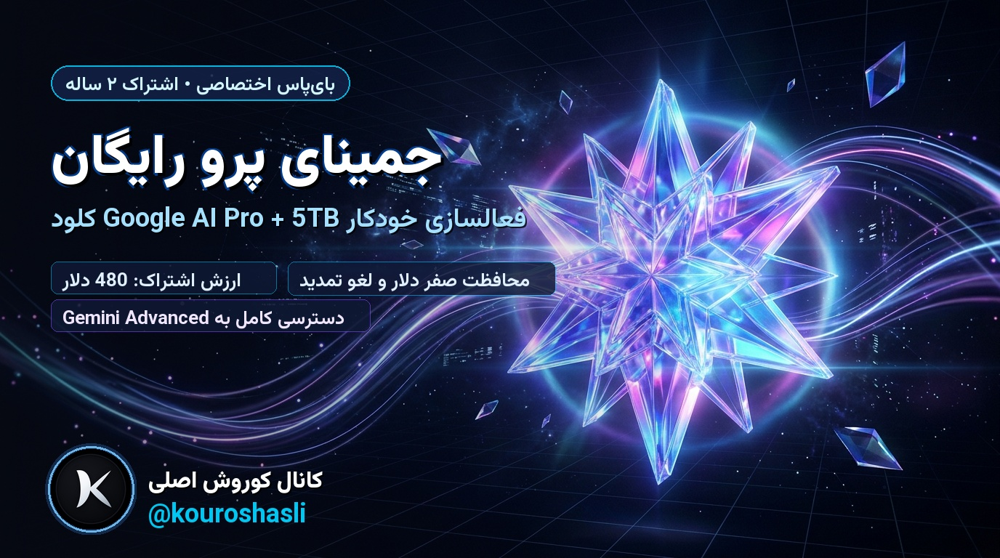

# 🚀 فعال‌ساز خودکار ۲ ساله Google AI Pro (Gemini Advanced + 5TB Cloud)

> **کنترل پنل کاملاً خودکار جهت دریافت ۲۴ ماه اشتراک رایگان Google AI Pro (ارزش ۴۸۰ دلار) با هزینه صفر ($0.00)**

---

### 📌 سلب مسئولیت
این پروژه صرفاً با اهداف پژوهشی، آموزشی و بررسی پروتکل‌ها و آسیب‌پذیری‌های سیستم‌های پروموشن توسعه داده شده است. مسئولیت استفاده از آن بر عهده کاربر می‌باشد.

---

### ⚙️ پیش‌نیازها و محیط اجرا
1. **سیستم‌عامل:** ویندوز 10 یا 11 (Windows 10 / 11)
2. **مرورگر:** Google Chrome (نصب‌شده در مسیر پیش‌فرض)
3. **پایتون:** نسخه 3.10 یا بالاتر (هنگام نصب پایتون حتماً تیک `Add Python to PATH` را بزنید)
4. **اینترنت / پروکسی:** آی‌پی کشور آمریکا (US) با کیفیت مطلوب یا وارد کردن قالب پروکسی در پنل برنامه

---

### 🚀 راهنمای سریع راه‌اندازی
1. برای اولین بار، فایل **`1_نصب_پیش‌نیازها_و_اجرا.bat`** را اجرا کنید تا پکیج‌های مورد نیاز (FastAPI, Playwright و ...) خودکار نصب شوند.
2. در دفعات بعدی، کافیست فایل **`2_اجرای_برنامه.bat`** را اجرا کنید.
3. مرورگر شما به‌طور خودکار صفحه کنترل پنل را باز خواهد کرد:
   👉 `http://127.0.0.1:8765`

---

### 📋 راهنمای تنظیمات و فعال‌سازی اکانت‌ها

#### ۱. تنظیم کارت بانکی (بدون موجودی / تست):
* در پنل سمت چپ در بخش **«تنظیمات کلی و اتصال کارت معاف از مالیات»**، اطلاعات کارت ارزی (Visa یا Mastercard) را وارد کنید:
  * شماره ۱۶ رقمی کارت
  * تاریخ انقضا (ماه / سال مانند 08 / 29)
  * کد امنیتی (CVC سه‌رقمی)
  * نام دارنده کارت به انگلیسی
  * کد پستی معاف از مالیات به صورت پیش‌فرض روی `97201` (ایالت اورگان آمریکا) تنظیم است و نیازی به تغییر ندارد.
* روی دکمه **«💾 ذخیره تنظیمات»** کلیک کنید.
* *نکته امنیتی:* اسکریپت دارای سیستم حفاظتی دقیق صفر دلار است؛ یعنی تنها در صورتی روی دکمه اشتراک کلیک می‌کند که مبلغ نهایی دقیقاً **US$0.00** باشد.

#### ۲. وارد کردن دسته‌ای اکانت‌های گوگل:
* در بخش سمت راست، اکانت‌های گوگل خود را (هر اکانت در یک خط) با یکی از فرمت‌های زیر وارد کنید:
  * `ایمیل----رمزعبور----ایمیل‌پشتیبان`
  * `ایمیل----رمزعبور----ایمیل‌پشتیبان----کلید2FA`
  * `ایمیل----رمزعبور----کلید2FA`
* روی دکمه **«➕ افزودن به لیست»** کلیک کنید.

#### ۳. شروع فرایند خودکار:
* برای هر اکانت روی دکمه **«▶ اجرا»** یا برای تمام اکانت‌ها روی **«▶ اجرای خودکار همه»** کلیک کنید.
* مراحل اجرای خودکار اسکریپت:
  * **مرحله ۱:** لاگین خودکار به گوگل و عبور هوشمند از تایید هویت (ایمیل پشتیبان یا 2FA)
  * **مرحله ۲:** اتصال کارت معاف از مالیات + فعال‌سازی پکیج اول ۱۲ ماهه رایگان ($0.00)
  * **مرحله ۳:** هم‌پوشانی و اعمال پکیج دوم ۶ ماهه رایگان ($0.00 -> افزایش به ۱۸ ماه)
  * **مرحله ۴:** هم‌پوشانی و اعمال پکیج سوم ۶ ماهه رایگان ($0.00 -> رسیدن به ۲۴ ماه سقف نهایی)
  * **مرحله ۵:** مراجعه خودکار به Google Play و لغو تمدید خودکار جهت جلوگیری از هرگونه کسر هزینه در آینده و قفل نهایی امتیاز ۲ ساله همراه با اسکرین‌شات تأییدیه.

---

### 💡 توصیه‌های امنیتی مهم
* حتماً از **اکانت جدید یا فرعی گوگل** استفاده کنید.
* کارت متصل‌شده بهتر است کارت مجازی، فیک‌تست یا بدون موجودی باشد.

---

📢 **ارائه‌شده در کانال تلگرام:** [کانال کوروش اصلی (@kouroshasli)](https://t.me/kouroshasli)
